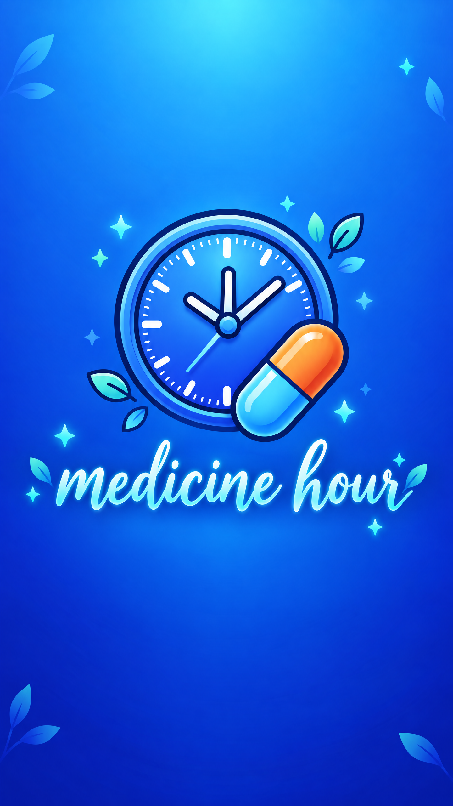

<div id="top">

<!-- HEADER STYLE: BANNER -->
<div align="center">



</div>

---

## 📄 Table of Contents

- [📄 Table of Contents](#-table-of-contents)
- [✨ Overview](#-overview)
- [📌 Features](#-features)
- [🚀 Getting Started](#-getting-started)
    - [📋 Prerequisites](#-prerequisites)
    - [⚙ ️ Installation](#-installation)
    - [💻 Usage](#-usage)
    - [🧪 Testing](#-testing)

---

## ✨ Overview

An iOS application designed to help patients manage their medication schedules and receive timely dose reminders throughout their treatment.

---

## 📌 Features

<code>❯ Manage your treatment, Local Notifications, Photo Library, CRUD medicines </code>

---

## 🚀 Getting Started

### 📋 Prerequisites

This project requires the following dependencies:

- **Programming Language:** Swift

### ⚙️ Installation

Build remedioHora.git from the source and intsall dependencies:

1. **Clone the repository:**

    ```sh
    ❯ git clone https://github.com/mateusRodriguesSantos/remedioHora.git
    ```

2. **Navigate to the project directory:**

    ```sh
    ❯ cd remedioHora.git
    ```

### 💻 Usage

Run the project with:

Xcode 26.6 from Apple

### 🧪 Testing

Remediohora.git uses the Swift Testing test framework. 


